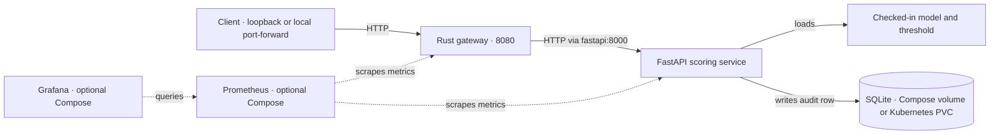

# Credit Default Decision Service

A portfolio project that takes a trained credit-default model from a notebook to a testable service. A Rust gateway forwards requests to FastAPI, which estimates next-month default risk for an **existing** credit-card customer and records each successful score in SQLite.

The API returns a probability and a **review flag**. The checked-in model uses a threshold of **0.15**. The project has been exercised with local containers and a disposable Kubernetes cluster in GitHub Actions.

[Quick demo](#quick-demo) · [Architecture](#architecture) · [Verification](#verification) · [Model evaluation](#model-evaluation) · [Limitations](#limitations)

## Quick demo

From the repository root, use Docker with the Compose plugin and a Bash-compatible shell with `curl`. The demo uses the checked-in model and a synthetic input. Once the images have built, the requests take a few seconds.

```bash
docker compose -p credit-demo up --build --wait
curl --noproxy 127.0.0.1 -fsS -w '\n' http://127.0.0.1:8080/health

curl --noproxy 127.0.0.1 -fsS -w '\n' -H 'Content-Type: application/json' --data-binary @- \
  http://127.0.0.1:8080/predict <<'JSON'
{
  "LIMIT_BAL": 20000, "SEX": 2, "EDUCATION": 2, "MARRIAGE": 1, "AGE": 35,
  "PAY_0": 0, "PAY_2": -1, "PAY_3": -1, "PAY_4": 0, "PAY_5": 0, "PAY_6": -1,
  "BILL_AMT1": 3913, "BILL_AMT2": 3102, "BILL_AMT3": 689, "BILL_AMT4": 0,
  "BILL_AMT5": 0, "BILL_AMT6": 0, "PAY_AMT1": 0, "PAY_AMT2": 689,
  "PAY_AMT3": 0, "PAY_AMT4": 0, "PAY_AMT5": 0, "PAY_AMT6": 0
}
JSON
```

Health reports the model and threshold. The prediction returns HTTP 200, writes one audit row, and returns the following JSON.

```json
{"default_probability": 0.3174, "threshold": 0.15, "decision": 1}
```

Try an empty JSON object to see a validation error through the same gateway. It returns HTTP 422 and adds zero audit rows.

```bash
curl --noproxy 127.0.0.1 -sS -i -H 'Content-Type: application/json' --data '{}' http://127.0.0.1:8080/predict
docker compose -p credit-demo down
```

The demo's SQLite volume survives `down`. For a disposable project whose data you want to remove, use `docker compose -p credit-demo down -v`. See the [Kubernetes runbook](k8s/README.md#windows-docker-desktop-and-powershell) for PowerShell instructions or the [hosted kind run](https://github.com/MarlonPC32/credit-default-decision-service/actions/runs/44679995338) to see the integration test without installing tools.

## Architecture



| Component | Responsibility |
|---|---|
| **Rust** | Axum and Tokio serve HTTP. The gateway bounds request bodies, relays FastAPI responses, and maps upstream failures and timeouts. [Gateway guide](rust-runtime/README.md) |
| **FastAPI and SQLite** | Pydantic validates the input. FastAPI preprocesses it, runs the scikit-learn model, applies the threshold, and appends the decision to SQLite. [Service](src/app.py) |
| **Docker Compose** | Runs both services as non-root containers. Only the gateway is published, on `127.0.0.1:8080`. FastAPI uses internal DNS and a named volume for SQLite. [Compose file](compose.yaml) |
| **Kubernetes** | Internal Services provide DNS, probes control readiness and restarts, and a persistent volume claim (PVC) holds SQLite. Local access uses a gateway port-forward. [Runbook](k8s/README.md) |
| **Bazel** | Builds and tests the Rust gateway on Linux x86-64 using Bzlmod and the existing Cargo dependency definitions. The Docker builds use Cargo and pip. [Module](MODULE.bazel) |
| **GitHub Actions** | Runs Rust, Python, Bazel, Docker, and observability checks. A separate workflow creates, tests, and deletes a single-node kind cluster. [CI](.github/workflows/ci.yml) · [kind workflow](.github/workflows/kubernetes-integration.yml) |
| **Prometheus and Grafana** | Prometheus scrapes both services. Grafana charts request rate, HTTP errors, p95 latency, and upstream health. [Optional Compose file](compose.observability.yaml) |

## Verification

The linked runs record successful checks at the audited implementation commit `7c7874e`. See [Actions](https://github.com/MarlonPC32/credit-default-decision-service/actions) for later runs.

| Check | Verified result |
|---|---|
| Cargo | Formatting and locked build passed. **11 Rust tests passed**, including forwarding, size limits, upstream failures, timeouts, and metrics. [CI run](https://github.com/MarlonPC32/credit-default-decision-service/actions/runs/44679995342) |
| Python | **10 passed, 1 skipped**. The skip requires the optional raw UCI spreadsheet. Tests cover preprocessing, validation, model loading, audit writes, and telemetry. [CI run](https://github.com/MarlonPC32/credit-default-decision-service/actions/runs/44679995342) |
| Bazel | Locked gateway build and Rust test target passed on Ubuntu x86-64 with Bazel 8.5.0. [CI run](https://github.com/MarlonPC32/credit-default-decision-service/actions/runs/44679995342) |
| Docker and observability | Both application images built. Prometheus scraped both services, Grafana queried the provisioned datasource, and the smoke test checked request metrics and sanitized logs. [CI run](https://github.com/MarlonPC32/credit-default-decision-service/actions/runs/44679995342) |
| Kubernetes | Hosted single-node kind verified ready Pods, Service DNS, a writable bound PVC, HTTP 200/400/422, zero rows for invalid requests, and one audit row that survived FastAPI Pod replacement. [kind run](https://github.com/MarlonPC32/credit-default-decision-service/actions/runs/44679995338) |
| Windows runbook | PowerShell blocks passed syntax checks. Live Kubernetes verification used hosted kind on Ubuntu. [PowerShell instructions](k8s/README.md#windows-docker-desktop-and-powershell) |

## Model evaluation

The [UCI Default of Credit Card Clients dataset](https://archive.ics.uci.edu/dataset/350/default+of+credit+card+clients) contains 30,000 historical records from Taiwan with 6,636 defaults (22.12%). The 23 features cover credit limit, demographics, repayment history, bills, and payments. The [preprocessing module](src/preprocessing.py) shares feature ordering and category normalization between training and serving. It drops the original ID and renames the target to `default`.

[Training](src/train.py) uses a stratified 60/20/20 train/validation/test split with seed 42. It compares logistic regression and histogram gradient boosting (HGB), selects the model and threshold on validation, and evaluates the frozen choice on 6,000 held-out rows. [Exploration notebook](notebooks/01_eda.ipynb) · [Modeling notebook](notebooks/02_modeling.ipynb) · [Checked-in metadata](models/metadata.json)

### Current threshold and historical context

- **Current threshold: 0.15.** HGB had the lowest validation cost on the 0.10–0.90 grid with steps of 0.05. The illustrative cost is `5 × false negatives + false positives`. HGB cost **3,426** at 0.15 and **3,837** at 0.30 on the current validation set.
- **Historical threshold: 0.30.** The first artifact selected from three thresholds using the same test split on which it reported performance. The later validation-first protocol selected 0.15, and the model binary was regenerated. The evaluation protocols differ. [Original metadata](https://github.com/MarlonPC32/credit-default-decision-service/blob/79c335ea0aa016b03ec3d9debd6113ff4ffe2e6d/models/metadata.json) · [Protocol change](https://github.com/MarlonPC32/credit-default-decision-service/commit/5e058a9e89910bd462f38d0b6ee7deddd069f747) · [Model regeneration](https://github.com/MarlonPC32/credit-default-decision-service/commit/a56c3ce0b5dcf8cf528adadb08a31bb49af88492)

| Held-out metric | Value |
|---|---:|
| ROC-AUC | 0.7858 |
| Recall | 0.7943 |
| Precision | 0.3532 |
| F1 | 0.4890 |
| Accuracy | 0.6328 |
| Always predict no default · accuracy | 0.7788 |
| HGB illustrative cost | 3,295 |
| Always predict no default · illustrative cost | 6,635 |

The threshold prioritizes catching more defaults and flags more good customers for review. Cost is reported in assumed units. Validation Brier score was **0.1381**. The reliability curve has few high-probability examples, so interpret that range cautiously. [Modeling notebook](notebooks/02_modeling.ipynb)

## Developer guide

### HTTP and audit behavior

| Endpoint or condition | Behavior |
|---|---|
| `GET /health` | Reports the model and threshold through the gateway. |
| `POST /predict` | FastAPI validates the 23 features, scores the record, and writes one row for a successful prediction. |
| Client errors | The gateway relays FastAPI's HTTP 400 for body decoding and 422 for invalid JSON or fields. The gateway returns 413 for bodies over 64 KiB. |
| Upstream failures | The gateway returns 502 for connection errors or unexpected statuses and 504 for a non-connection upstream timeout. It applies a five-second outbound deadline and disables its own retries and redirects. |
| `GET /metrics` | Both services expose Prometheus counters and latency histograms. The gateway also counts upstream failures by reason. |

FastAPI compares the full-precision score with 0.15 using `>=`, then rounds the response probability to four decimal places. Use the returned `decision` near the boundary. SQLite stores a timestamp, SHA-256 digest of the validated input, full-precision score, threshold, and decision. [FastAPI implementation](src/app.py) · [Rust implementation](rust-runtime/src/main.rs)

| Setting | Local default or example |
|---|---|
| `FASTAPI_BASE_URL` | Required by the gateway. Use `http://127.0.0.1:8000` for native development. Compose and Kubernetes set `http://fastapi:8000`. |
| `GATEWAY_BIND_ADDR` | Defaults to `127.0.0.1:8080`. Container configurations bind to `0.0.0.0:8080` inside the container. |
| `DECISIONS_DB` | Native default is `data/decisions.db`. Compose and Kubernetes use `/var/lib/credit-default/decisions.db` on their mounted volumes. |

### Native setup and checks

Use Python 3.12.14 and Rust 1.91.1 to match CI. Run the Python commands in a virtual environment from the repository root. The [gateway guide](rust-runtime/README.md#run-locally) shows how to start the two processes in separate terminals.

```bash
python -m pip install --only-binary=:all: -r requirements.txt -c requirements-docker.lock
python -m pip check
OMP_NUM_THREADS=2 python -m pytest tests/ -q -rs
(cd rust-runtime && cargo fmt --check && cargo test --locked && cargo build --locked)
```

The checked-in artifacts support the demo without training. To regenerate them deliberately, run `OMP_NUM_THREADS=2 OPENBLAS_NUM_THREADS=2 python -m src.train`. The optional raw-file test uses the spreadsheet fetched by `python scripts/download_data.py` when the UCI archive is reachable.

### Bazel on Linux x86-64

Use Bazel 8.5.0. Bzlmod pins the rules, and `rules_rust` reads `rust-runtime/Cargo.toml` and `rust-runtime/Cargo.lock`. The first build downloads the rules, Rust 1.91.1 toolchain, and crates.

```bash
bazel build --lockfile_mode=error //rust-runtime:credit-default-gateway
bazel test --lockfile_mode=error --test_output=errors //rust-runtime:gateway_test
```

After changing Cargo dependencies, refresh `Cargo.lock` with Cargo and run Bazel without `--lockfile_mode=error` to refresh `MODULE.bazel.lock` if needed. Review both lockfiles.

### Optional monitoring

Start from a fresh Compose project for the smoke test. Stop the quick demo first to free port 8080. The smoke script sends one synthetic validation failure and checks fresh counters, Grafana's datasource query, and structured logs.

```bash
export COMPOSE_PROJECT_NAME=credit-observability-demo
docker compose -f compose.yaml -f compose.observability.yaml up --build --wait
python3 observability/smoke.py
docker compose -f compose.yaml -f compose.observability.yaml logs --tail 50 gateway fastapi
```

Open Grafana at `http://127.0.0.1:3000/d/credit-service` (local anonymous viewer) and Prometheus targets at `http://127.0.0.1:9090/targets`. Generate requests over at least two five-second scrape intervals to see rates. The logs include method, normalized route, status, duration, and gateway upstream failure reasons. They omit raw URLs, bodies, headers, and audit hashes. Use `docker compose -f compose.yaml -f compose.observability.yaml down` to stop the stack and preserve named volumes. Prometheus retains seven days of history.

### Builds behind a TLS-inspecting proxy

Use the standard Compose command with publicly trusted registries. If the build environment requires an approved additional CA, save this override as `compose.cloud.yaml` outside the checkout. The example uses the Codex Linux CA bundle.

```yaml
services:
  fastapi:
    build:
      secrets: [build_ca]
  gateway:
    build:
      secrets: [build_ca]
secrets:
  build_ca:
    file: /etc/ssl/certs/ca-certificates.crt
```

Use `docker compose -f compose.yaml -f /path/to/compose.cloud.yaml up --build --wait`. Include `-f compose.observability.yaml` when starting monitoring. BuildKit mounts the bundle only during package downloads, with TLS verification enabled.

## Limitations

- **Evaluation scope.** One historical cohort and one stratified split support the reported metrics. Temporal validation, cross-validation, generalization to other populations, and fairness review remain outside the evaluation. The flag is for review of existing customers.
- **Operational scope.** The project was exercised in local containers and single-node hosted kind. The local PVC survived a Pod replacement. Node failover, multi-node storage, and production deployment remain outside that scope.
- **Audit semantics.** SQLite serializes writers. The manifests use one FastAPI replica and a `Recreate` update strategy. If a response is lost after the database commit, a client retry can create a second row. Treat the database as sensitive, including its deterministic hashes.
- **Access and monitoring.** The demo relies on loopback and internal networking. Application authentication and TLS are outside its scope. The Grafana viewer is intended for local use, and the dashboard shows service behavior rather than model drift or calibration.

## Repository map

| Path | Contents |
|---|---|
| [`rust-runtime/`](rust-runtime/) | Gateway, telemetry, and Rust tests |
| [`src/`](src/), [`tests/`](tests/) | Python service, preprocessing, training, and tests |
| [`models/`](models/), [`data/`](data/), [`notebooks/`](notebooks/) | Model artifacts, cleaned dataset, and evaluation |
| [`k8s/`](k8s/), [`observability/`](observability/) | Local Kubernetes and monitoring definitions, runbooks, and smoke tests |
| [`.github/workflows/`](.github/workflows/) | Build, test, and hosted kind workflows |
